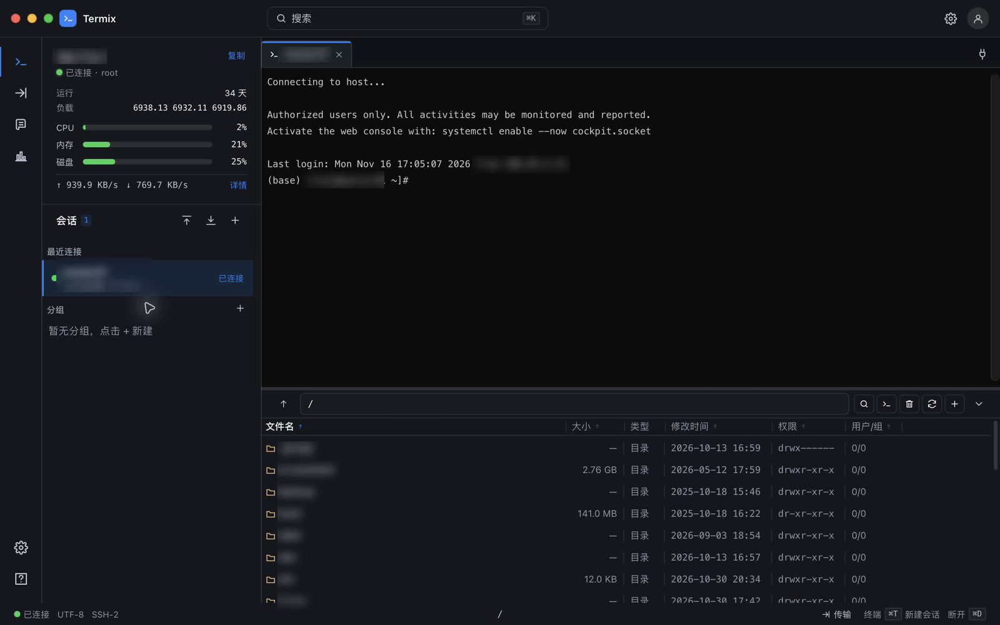

# Termix

跨平台（macOS / Windows）SSH 终端连接工具，对标 MobaXterm / FinalShell，集成连接管理、多标签终端、SFTP、端口转发、系统监控等能力。基于 Tauri 2 构建，**安装包小（5-15MB）、内存占用低（约为 Electron 1/3）**。

<p align="center">
  
</p>

---

## 功能特性

### 连接管理
- 新建 / 编辑 / 删除 / 分组 SSH 连接，**四种认证**：密码 / 私钥 / 键盘交互（2FA，按服务端提示输验证码）/ SSH Agent（本机密钥）
- **跳板机**：可选另一已保存会话作为跳板（仅一级），跳板主机密钥同样走 TOFU 校验
- **SSH Agent 转发**（ssh -A）：连接时可勾选，远端可复用本机 Agent 密钥继续跳转
- 会话侧边栏：最近连接、分组、在线/离线/连接中状态圆点，双击打开终端
- **拖拽分组**：最近连接或分组内的会话可拖到任意分组，也可拖到“移到未分组”移出分组
- **服务器概览**：IP、运行时长、负载、CPU / 内存 / 磁盘占比与网络速率；未连接时显示占位状态
- 会话右键菜单：在新标签连接 / 编辑 / 复制连接信息 / 删除
- **会话导入/导出**：JSON 备份（含分组），同名去重合并，导出时解锁主密码可导出明文密码
- **ssh config 导入**：一键读取 `~/.ssh/config` 或选择文件，自动识别 Host / HostName / User / Port / IdentityFile
- **自动备份**：会话/分组每次变更写滚动快照（最新 10 份），设置页可一键恢复
- 标题栏全局搜索（按名称 / 主机 / 用户名过滤）

### 终端与文件面板（一体化）
- **终端与文件面板一体化**：SSH 终端窗口 + 可唤出的底部命令输入区，底部文件面板展示远程文件系统（可收起）；切换到监控 / 设置等模块时终端仅隐藏不卸载，SSH 会话输出与状态不丢失
- 多标签终端（xterm.js），标签右键：关闭 / 关闭其他 / 关闭右侧 / 复制标签 / 分屏 / 重命名标签
- **终端右键菜单**：复制 / 粘贴 / 查找 / 清屏；多行粘贴先确认再发送
- **终端滚动与复制粘贴**：右侧常显滚动条，支持长时间输出回看；`Cmd/Ctrl+C`、`Cmd/Ctrl+V` 复制粘贴
- 终端内操作：**终端内搜索**（Ctrl+F）、保存日志（右键菜单）、清空输出、断开连接
- 命令输入区（Ctrl+L 唤出）：执行、历史下拉（按会话持久化、上下键切换）；终端直接输入 / 底部输入框 / 快捷命令共享同一份历史
- **快捷命令面板**：搜索片段 + 一键发送 + `{{var}}` 变量填充（位于文件面板工具栏）
- 快捷键：`⌘/Ctrl+T` 新建连接、`⌘/Ctrl+D` 断开、`Ctrl+/-` 字号缩放、`Ctrl+F` 终端内搜索
- 命令片段：CRUD + 一键插入 + `{{var}}` 变量交互填充
- **SSH 心跳保活**（keepalive 30s×3，空闲保活、断线自动重连）；意外断线自动重连（最多 3 次）

### SFTP 文件面板
- 远程文件列表：**名称 / 大小 / 类型 / 修改时间 / 权限 / 属主六列展示**，点击列头排序，列宽内容自适应且可拖动调整
- **首屏快速展示**：目录列表先返回，目录大小与 uid / gid 用户组映射后台补充，避免大目录首次加载卡顿
- 上传（拖拽系统文件入面板）/ 下载 / 新建文件夹 / 新建文件 / 删除 / 重命名；目录递归传输
 - 上传（拖拽系统文件 / 目录入面板）/ 下载 / 新建文件夹 / 新建文件 / 删除 / 重命名；目录递归传输
- **本地文件面板**：工具栏切换本地文件栏，浏览本地目录、上传/下载、右键新建/重命名/删除，支持与远程列表双向拖拽
- **右键菜单**：远程（下载 / 下载目录 / 重命名 / 删除 / 复制路径）+ 空白区（新建文件夹 / 刷新）
- 下载防呆：本地目标目录已存在同名文件 / 目录时先确认再执行
- **断点续传**：上传/下载暂停后可继续；连接中断会在重连后自动续传，恢复前校验源文件路径、大小、mtime 与首段 SHA-256，半成品不一致时从头发送；目录传输目前仅支持取消
- 传输队列：FinalShell 风格**悬浮小窗**（默认 430×300，可拖动/缩放并记住位置），传输开始自动弹出、不挤压终端；展示下载目录、任务位置、进度、大小、速率与剩余时间，支持逐条暂停/恢复、失败重试、**单条删除**和**清空当前队列**
- 加载中 / 错误提示 / 重试节流；连接失效后文件面板自动重绑当前会话

### 数据与下载目录
- Windows 安装版：数据库与自动备份保存在安装目录下的 `data` 文件夹（`termix.db`、`backups/`）；旧版 AppData 数据首次启动时自动复制迁移
- 默认下载目录：Windows 安装目录下的 `downloads`；可在设置 → 文件与数据中修改，留空恢复默认
- 覆盖更新：Windows 应用内更新会以 `/UPDATE` 启动 NSIS，覆盖程序文件并保留安装目录下的 `data`、`downloads`；手动安装时请装回原目录，不要先卸载。卸载时只有选择“不删除数据”才会保留连接信息。
- 卸载：交互式卸载会询问是否删除全部数据；选择删除后清理 `data`、`downloads`、AppData 与 WebView 缓存。自定义下载目录会二次确认；共享目录（用户主目录、桌面、文档、系统下载目录）会被跳过，避免误删。静默卸载保留数据。

### 端口转发（本地 / 远程 / 动态 SOCKS5）
- 规则 CRUD、启停、编辑，端口占用检测
- 本地转发：隧道双向拷贝
- 远程转发：服务端监听（`tcpip-forward`），连接经 `forwarded-tcpip` 通道转发到本地目标
- 动态代理：本地 SOCKS5，支持 IPv4 / 域名 / IPv6 目标

### 系统监控
- 右侧可展开面板：CPU / 内存 / 磁盘 / 网络速率 / 网络连接数（颜色分级）
- **单一数据源**：右侧面板与「监控」模块由同一轮询驱动，两处数据完全一致
- 监控详情页：指标卡 + CPU 实时曲线 + **CPU 核心数 / 主频** + **运行时长**（独立递增）+ 磁盘分区详情 + 进程 Top
- 刷新间隔可在设置中调整（1 / 2 / 5 秒）

### 安全与界面
- 主密码（PBKDF2 + AES-256-GCM）加密会话密码 / 私钥密码，支持设置 / 修改 / 解锁 / 锁定 / 清除
- **中英双语界面**：设置 → 通用切换语言，即时生效（含帮助文档）
- **同步输入**：状态栏一键开启，输入同步到其他已连接终端（含分屏），适合批量运维
- 深色 / 浅色 / 跟随系统主题、字号、光标样式、滚动缓冲区
- macOS / Windows 差异化标题栏：macOS 左侧交通灯，Windows 右侧最小化 / 最大化 / 关闭，快捷键提示自动切换 `⌘` / `Ctrl`
- 终端文件面板分隔条可拖拽调整高度，标题栏、活动栏与侧栏使用连续分隔线

> 说明：当前面向 **Linux 类服务器**（终端 / SFTP / 转发 / 监控均基于 Unix 命令）。远程 Windows 服务器（编码、监控兼容）暂未接入。

---

## 技术栈

| 层 | 选型 |
|---|---|
| 桌面框架 | Tauri 2（复用系统 WebView） |
| 后端 | Rust（tokio + russh / russh-sftp / ring / rusqlite） |
| 前端 | React 18 + TypeScript + Vite + Zustand + xterm.js |
| 存储 | SQLite（rusqlite bundled） |
| 日志 | env_logger（`RUST_LOG=debug` 输出传输/转发细节） |

---

## 分支模型

- `main`：稳定发布分支，只保留已发版代码；**发版 = 合并到 main 后打 `v*` tag**。
- `dev`：日常开发分支，功能与修复先合入这里；在 dev 上打 tag 不会触发构建
  （`release.yml` 有 main 归属校验）。
- `feature/*`：较大改动可再开特性分支，完成后合回 `dev`。

发布流程：`dev` → PR/合并到 `main` → 推送 `v*` tag → CI 构建并发布。

### Tag 约定

| 场景 | Tag 示例 | 是否产出安装包 |
|---|---|---|
| 正式发布（main 上） | `v1.0.3` | ✅ 构建 DMG / EXE / 源码包 |
| 开发快照（dev 上） | `v1.1.0-rc.1`、`dev-20261118` | ❌ workflow 正常运行但跳过全部构建 |

`release.yml` 的 `guard` 会校验 tag 所属提交是否在 `main`：
在 dev 上打 tag 不会报错，只是不产出产物；想让 tag 真正发版，必须先合并到 `main`。
tag 创建不做任何限制，任何分支都可以打 tag，是否发版只由「tag 是否在 main 上」决定。

### 安装未签名版本（macOS）

当前发布包未做 Apple 签名与公证，首次打开会被 Gatekeeper 拦截，任选一种方式放行：

- 右键 `Termix.app` → **打开** → 再点「打开」（macOS 14 及更早）
- 系统设置 → 隐私与安全性 → 底部「仍要打开」（macOS 15 起）
- 终端执行：`xattr -dr com.apple.quarantine /Applications/Termix.app`

自行编译（`npm run tauri build`）或通过应用内更新下载的安装包通常不带隔离属性，可直接打开。

## 快速开始

```bash
# 1. 安装前端依赖
npm install

# 2. 开发运行（macOS 需在系统终端执行）
npm run tauri dev

# 3. 详细日志模式
RUST_LOG=debug npm run tauri dev

# 4. 构建安装包（macOS .dmg / Windows .exe）
npm run tauri build
```

### 运行单元测试

```bash
cd src-tauri && cargo test   # Rust 后端（66 个用例）
npm test                     # 前端 Vitest（139 个用例）
npm run test:coverage        # 前端覆盖率报告（coverage/）
npm run test:ssh             # 启动本地隔离 sshd 并跑 SSH/SFTP 集成测试
scripts/check-en-ui.sh       # 真实构建产物英文界面自检（需本机 Chrome）
```

> 网络类功能（SSH / SFTP）默认不跑集成测试；`npm run test:ssh` 会用本地隔离 sshd 验证连接、SFTP 与 Agent 认证。

---

## 官网

`website/` 是可直接部署的静态官网（中英双语，`?lang=en` 直达英文）。推送 `main` 后由 `.github/workflows/pages.yml` 自动发布到 GitHub Pages（需在仓库 Settings → Pages 选择 “GitHub Actions”）。

---

## 项目结构

```
Termix/
├── src/                     # 前端（React + TS）
│   ├── components/          # 标题栏 / 服务器概览 / 终端与文件面板 / 转发 / 监控 / 设置等
│   ├── store/               # zustand 全局状态（app.ts）与监控单一数据源（monitor.ts）
│   ├── lib/                 # IPC 封装、终端注册表、缓存/筛选/选择、窗口控制、SFTP 菜单等
│   ├── styles/              # 设计 token + 全局样式（深/浅主题）
│   └── assets/icons/        # SVG 图标
└── src-tauri/               # 后端（Rust）
    ├── src/
    │   ├── main.rs          # 入口、命令注册、日志初始化
    │   ├── commands.rs      # Tauri IPC 命令
    │   ├── crypto.rs        # 主密码加密（PBKDF2 + AES-256-GCM）
    │   ├── ssh.rs           # SSH 连接 / 终端 channel / 远程转发回调
    │   ├── sftp.rs          # SFTP 操作 + 传输任务队列（断点续传 / 暂停恢复）
    │   ├── forward.rs       # 端口转发（本地 / 远程 / 动态 SOCKS5）
    │   ├── db.rs            # SQLite（会话/分组/历史/片段/转发/设置）
    │   └── models.rs        # 数据模型
    └── Cargo.toml
```

---
